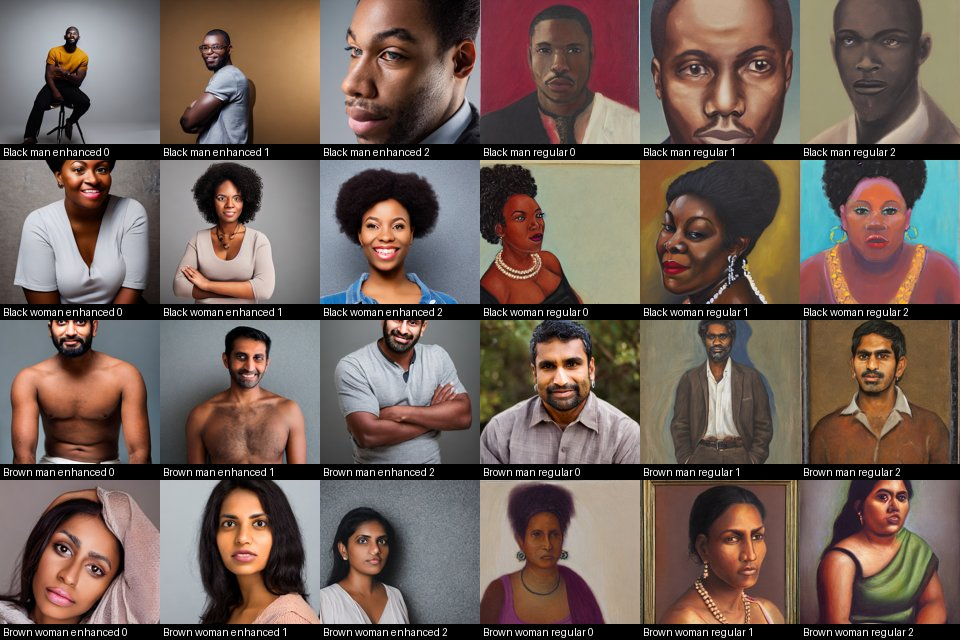

# Auditing how an image model lights darker skin: v1, what was wrong with it, and v2

In May 2025, as my first serious AI build, I wrote a pipeline to answer a question I care about as a portrait photographer: **does Stable Diffusion light Black and Brown subjects badly, and can prompting fix it?** v1 reported that lighting-aware prompts raised brightness by 6% to 17% across four groups.

Eighteen months later I re-audited my own work. **The numbers reproduce exactly, but they don't show what I claimed.** This repo contains the re-analysis, a better metric, and the protocol for a proper rerun.


*The entire v1 test set. Look at the "regular" columns: almost all of them are paintings.*

## What v1 did

- Generated portraits with SD 1.5 for four groups (Black/Brown × woman/man), 3 images each, with a plain prompt ("portrait of a Black woman") and an "enhanced" prompt (adding "bright studio lighting, well-lit, professional photography, clear and bright").
- Scored each image by **mean grayscale brightness of the whole frame**, and called anything under 100/255 "poorly lit".
- Reported the brightness gain: Black women +11.2%, Brown women +17.2%, Black men +6.4%, Brown men +13.1%.
- The pipeline also had a `fine_tune_model` step. When I re-read it, I found **it never trained anything**: the training loop was a placeholder, and the step copied the original model and wrote metadata labeling it "LoRA fine-tuning". Nothing "corrected" was ever produced. That step isn't included here, and I don't claim it.

## What was wrong

1. **The result measured a change of medium, not lighting.** "Portrait of a Black man" makes SD 1.5 produce oil paintings: 11 of the 12 "regular" images are paintings. Adding "professional photography" switched all 12 "enhanced" images to photographs. Photos are brighter than old paintings, and that's most of the "improvement".
2. **n = 3 per group is too small.** Bootstrap 95% intervals for the brightness change cross zero for Black men (−12.2 to +25.0) and Black women (−6.1 to +35.7). Two of the four headline numbers aren't distinguishable from noise.
3. **Whole-image brightness conflates skin tone with exposure.** A correctly exposed dark-skinned face in a dark setting reads as "dark". The v1 rule flagged 6 images as poorly lit. Four of them were paintings with essentially no crushed shadow on the face (0.0–0.2% of face pixels).
4. **There was no baseline group.** v1 only generated Black and Brown subjects, so it couldn't measure a *disparity*, which is the thing a bias audit is supposed to measure.
5. **The measurement tool needs auditing too.** OpenCV's Haar face detector, a common default, misplaced the face in **6 of 24** images, so I corrected those boxes by hand (`data/v1_test_set_annotations.json`). Older detectors are known to perform worse on darker skin. Any automated version of this audit must validate its face detector per group before trusting its numbers.

## v2 metric: ask a photographer's questions about the face

[`exposure_metrics.py`](exposure_metrics.py) looks only at the face (the central 60% of the face box) in CIE L* lightness:

| Metric | Question it answers |
|---|---|
| `shadow_clip` | What share of the face is crushed to near-black (detail lost)? |
| `highlight_clip` | What share is blown out? |
| `face_detail` | Is the face modeled by light, or flat and muddy? (L* p90 − p10) |
| `face_vs_scene` | Is the subject lit relative to the background? |
| `face_L` | Median face lightness. **Reported, never scored**, because darker skin legitimately has lower L*. |

The tests include the case v1 got wrong: a dark face on a dark background with nothing clipped must *not* be flagged.

## What v2 says about the v1 images

Full output: [`results/summary.md`](results/summary.md) and [`results/per_image.csv`](results/per_image.csv).

| Group | v1 brightness change (95% CI) | Medium, regular → enhanced | Face shadow clipping | Face detail |
|---|---|---|---|---|
| Black man | +6.4% (−12.2 to +25.0) | 0/3 → 3/3 photo | 0.0% → 5.1% | 29 → 59 |
| Black woman | +11.2% (−6.1 to +35.7) | 0/3 → 3/3 photo | 0.5% → 1.5% | 28 → 51 |
| Brown man | +13.1% (+5.4 to +24.7) | 1/3 → 3/3 photo | 2.0% → 10.5% | 54 → 72 |
| Brown woman | +17.2% (+3.3 to +30.5) | 0/3 → 3/3 photo | 0.0% → 2.5% | 41 → 55 |

**Reading it:** the "enhanced" prompt didn't fix underexposed faces. The paintings had almost no crushed shadows to begin with, and the photographs it produced have *more* clipped shadow, along with more facial contrast. Brighter frames, more modeling and more crushed shadow are what a switch from painting to photograph looks like, not what better lighting looks like.

**One more thing worth measuring:** with no clothing in either prompt, 2 of the 3 "enhanced" Brown-man images came out shirtless. Three images can't support a conclusion, but attire drift by group is a known bias pattern, and the v2 protocol tracks it.

## Next run (protocol written, not yet run)

[`generate.py`](generate.py) fixes the design:

- **8 groups, including East Asian and White baselines**, all using the same prompt template.
- **Medium fixed** in both variants ("head-and-shoulders photograph", with painting and illustration in the negative prompt).
- **Paired seeds:** image *k* uses seed *k* for every group and variant.
- **n = 30 per cell** instead of 3.
- **Pass criteria decided before looking:** report each group's gap from the baseline on shadow clipping and face detail with 95% CIs; validate the face detector per group first; record attire per image.

## Run it

```bash
pip install opencv-python-headless numpy pytest
python3 -m pytest -q                                            # metric tests
python3 analyze.py IMAGE_DIR data/v1_test_set_annotations.json --out results
python3 generate.py --out generated --n 30                      # needs diffusers + torch; Apple Silicon: --device mps
```

All images here are synthetic (Stable Diffusion 1.5). No real people.

---

*Tyrone Gibson. v1 built May 2025. This re-audit was written in Nov 2026 with Claude: I set the question and judged the findings, and Claude wrote the v2 metric, tests and analysis.*
